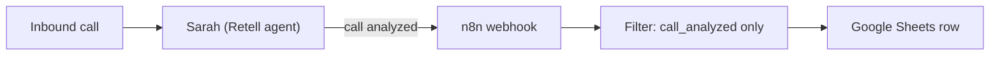

# Lead Qualifier for a Commercial Drywall Contractor

An inbound AI voice agent that answers calls for a drywall contractor, works out what kind of project the caller has, collects the project and contact details, and logs every qualified call to Google Sheets. Built on Retell AI and n8n.

## What it does

- "Sarah" answers the call and listens for what the caller wants: a quote, urgent capacity, help on an existing job, a general question, or a homeowner asking directly.
- For a quote, she asks the project type (single family, multi-family or commercial), then the follow-ups for that type: number of homes or units, location, start date, construction type or square footage, and scope (drywall only, or framing and insulation too).
- She collects the caller's name, company and email, asks them to spell the email and reads it back.
- She tells the caller which division lead will follow up, based on the project type and size.
- After the call, Retell's post-call analysis extracts the details and n8n appends them as a row in Google Sheets.

## How it works



## What's in this repo

```
agents/    Retell agent config
prompts/   Full agent prompt
n8n/       The n8n post-call workflow
```

## Stack

| Layer | Tool |
|---|---|
| Voice agent | Retell AI (gpt-4.1, ElevenLabs voice) |
| Orchestration | n8n |
| Lead log | Google Sheets |

## Post-call fields

| Field | What it holds |
|---|---|
| `project_type` | Single Family Homes or Multi-family Homes |
| `unit_amount` | Number of homes or units |
| `project_location` | State |
| `project_location_city` | City |
| `name` | Caller's name |
| `email` | Caller's email |
| `company_name` | Caller's company |

The n8n workflow writes these fields to the sheet along with the call details.

## Key design decisions

- **Route by intent first.** The greeting is open, and the agent picks one of five paths from what the caller says, so a homeowner or an existing client never sits through quote questions.
- **Questions depend on project type.** Single family, multi-family and commercial projects each get the follow-ups that matter for that type.
- **Name, email, state and city are never skipped.** The prompt makes them required, and the email is spelled out and read back so the follow-up reaches the right inbox.
- **Size decides the follow-up.** Larger single-family and multi-family projects go to the division lead, smaller ones to the wider team.
- **Only finished calls are logged.** The n8n filter passes only the `call_analyzed` event, so each call writes one complete row.

## Placeholders

| Placeholder | Replace with |
|---|---|
| `your-n8n-instance.example.com` | Your n8n base URL |
| `YOUR_WEBHOOK_PATH` | The webhook paths you choose |
| `YOUR_GOOGLE_SHEET_ID` | Your Google Sheet ID |
| `YOUR_SHEET_TAB` | Your sheet tab |

## License

All rights reserved. Published for viewing only. See [LICENSE](LICENSE).
